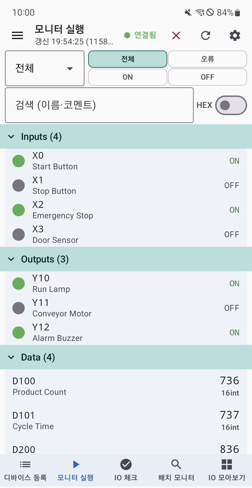
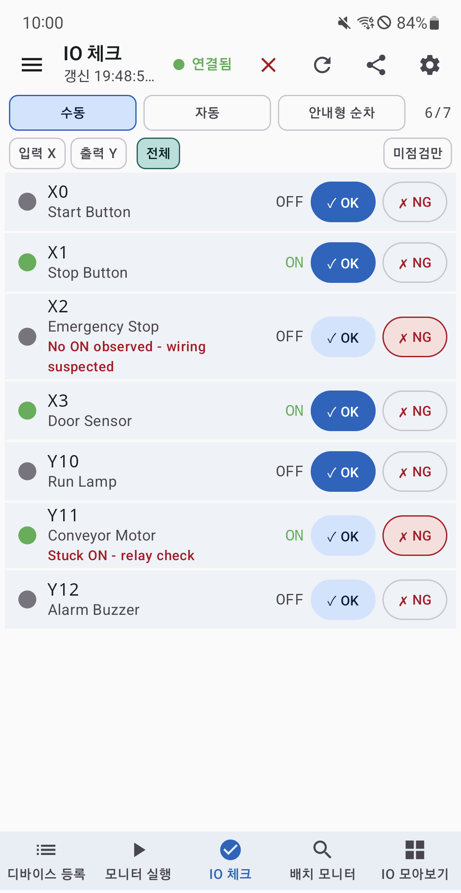
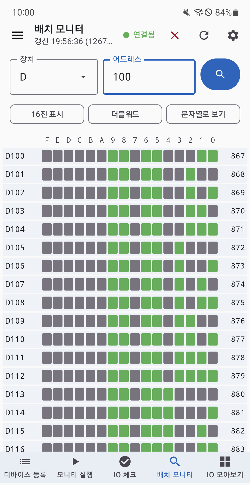

# PLC 엔지니어의 작은 업무수첩

**한국어** | [English](README.en.md)

**현장에서 스마트폰으로 MELSEC PLC의 입출력을 확인하고, 점검 결과를 기록하세요.**

PLC 업무수첩(구 PLC IO Check)은 Mitsubishi MELSEC PLC의 I/O 점검, 디바이스 모니터링과 현장 계산을 돕는 Android 앱입니다. PLC와 통신할 수 있는 네트워크에서 MC Protocol/SLMP로 값을 직접 읽습니다.

**[Google Play에서 설치](https://play.google.com/store/apps/details?id=com.plciocheck.iocheck&hl=ko)** | [제품 소개](https://plcmanjp.github.io/plc-io-check-helper/) | [문제 신고 및 기능 제안](https://github.com/plcmanjp/plc-io-check-helper/issues/new/choose)

Android 8.0 이상에서 사용할 수 있습니다. 최신 배포 버전과 기기 호환 여부는 Google Play에서 확인하세요. 이 저장소에서는 앱 소개와 도움말을 제공하며, 앱 소스 코드와 설치 파일은 배포하지 않습니다.

## 이런 작업에 활용하세요

| 현장에서 필요한 작업 | 앱에서 할 수 있는 일 |
| --- | --- |
| 센서와 출력 신호를 하나씩 점검할 때 | X/Y 입출력을 확인하고 OK/NG 판정과 점검 결과를 기록합니다. |
| 여러 디바이스 값을 함께 확인할 때 | 비트 ON/OFF와 워드 값을 모니터링하고, 배치 모니터에서 주소별 값을 표로 조회합니다. |
| 설비별 주소와 코멘트를 정리할 때 | 프로젝트와 그룹을 저장하고, 검색과 상태 필터로 필요한 항목을 찾습니다. |
| 값의 변화를 기록할 때 | 심플 로거에서 조건 또는 주기에 따라 이벤트를 기록합니다. |
| 현장 계산과 코드 확인이 필요할 때 | 진법, 아날로그 스케일, 체크섬, CRC 등 내장 계산기와 도구를 사용합니다. |

## 화면 미리보기

| 디바이스 모니터 | IO 체크 | 배치 모니터 |
| :---: | :---: | :---: |
|  |  |  |

화면 구성은 앱 버전과 설정에 따라 다를 수 있습니다.

## 처음 사용한다면

1. **앱을 설치하세요.** Google Play에서 `PLC 업무수첩: MELSEC IO 점검`을 설치합니다.
2. **연결 환경을 준비하세요.** 휴대전화에서 PLC의 IP 주소와 포트로 접근할 수 있는 네트워크가 필요합니다. PLC의 Ethernet 및 MC Protocol/SLMP 설정도 확인하세요.
3. **프로젝트와 연결을 설정하세요.** PLC 기종, IP 주소, 포트와 통신 형식을 실제 설비 설정에 맞춥니다. 연결 설정 화면의 도움말에서 GX Works 통신 설정 절차를 확인할 수 있습니다.
4. **디바이스를 등록하세요.** 주소를 직접 입력하거나 일괄 등록합니다. 기존 코멘트가 있다면 GX Works에서 내보낸 CSV를 가져오는 방법을 권장합니다.
5. **값을 확인하고 점검하세요.** 모니터링을 시작해 읽기 상태를 확인한 뒤 IO 체크에서 판정을 기록합니다. 설비에 신호를 인가하는 작업은 현장 안전 절차에 따라 별도로 진행하세요.

연결이 되지 않으면 PLC의 IP 주소, 포트, TCP/UDP, 프레임과 데이터 형식이 앱 설정과 일치하는지 먼저 확인하세요.

## 주요 기능

- **IO 체크:** 수동, 자동, 안내형 순차 모드로 점검하고 결과를 CSV와 요약 리포트로 공유합니다.
- **디바이스 모니터링:** X/Y/M/L/B 등의 비트 상태와 D/W/ZR 등의 워드 값을 확인합니다. 워드는 10진수, 16진수, 부호 있는 값, 32비트, 실수와 문자열로 표시할 수 있습니다.
- **프로젝트와 그룹:** 설비별 프로젝트, 계층형 그룹, 검색과 상태 필터를 지원합니다. `.plc` 파일로 프로젝트를 공유할 수 있습니다.
- **GX Works 가져오기:** 코멘트/래더 CSV, GX Works2 `.gxw`와 지원 범위의 GX Works3 FX5U `.gx3`에서 디바이스와 코멘트를 가져옵니다. 모든 GX3 기종과 데이터 형식을 지원하지 않으며, 지원하지 않는 프로젝트는 등록을 중단합니다.
- **심플 로거와 HMI:** 조건 또는 주기에 따른 이벤트 기록과 값 표시, 이동, 비트 상태에 따른 표시 기능을 제공합니다.
- **현장 도구 11종:** 프로그래머, 전자기어비, 원둘레, 삼각함수, 아날로그 스케일, 통신 코드, 시리얼 통신 시간, UVW 스테이지, Modbus RTU 프레임 생성기, ASCII 코드표와 ASCII 입력기를 제공합니다. 일부 도구는 [웹 엔지니어 도구](https://plcmanjp.github.io/engineer-tool/)에서도 사용할 수 있습니다.
- **언어와 테마:** 한국어, 영어, 일본어, 중국어 간체, 중국어 번체, 베트남어 및 라이트/다크 테마를 지원합니다.

## 연결 대상과 통신 방식

| 항목 | 안내 |
| --- | --- |
| MELSEC Q | QJ71E71-100 통신 모듈과 QnUDV CPU 내장 Ethernet 검증 구성이 있습니다. |
| MELSEC iQ-R | RJ71EN71 통신 모듈과 CPU 내장 Ethernet 검증 구성이 있습니다. |
| 통신 방식 | MC Protocol/SLMP, TCP/UDP, 3E/4E 프레임, Binary/ASCII를 지원합니다. |

연결 가능 여부와 읽을 수 있는 디바이스 범위는 CPU, 통신 모듈과 PLC 설정에 따라 달라집니다. 파일 가져오기 지원 범위와 실시간 통신 지원 범위는 서로 다릅니다.

## 무료 이용과 광고

- 기본 IO 체크, 모니터링, 심플 로거의 진입/열람/기록과 계산기 도구는 무료입니다.
- 디바이스 등록 수에는 제한이 없으며, 무료 모니터링은 목록 상위 50개 활성 디바이스를 대상으로 합니다.
- 하단 배너 광고가 표시됩니다. 선택형 보상형 광고를 완료하면 토큰 1개를 받습니다.
- 성공한 LOG/IO CSV 저장, GX Works 신규 등록/코멘트 병합 또는 하단 배너 12시간 제거에 토큰 1개를 사용합니다. 실패, 취소, 변경 0건에는 차감하지 않습니다.
- 인앱결제와 현금성 보상은 없습니다.

## 도움말과 문의

- [앱 소개와 주요 기능](https://plcman.tistory.com/236)
- [Q 시리즈 연결부터 IO 모니터링까지](https://plcman.tistory.com/237)
- [GX Works CSV 디바이스 등록 가이드](https://plcman.tistory.com/238)
- [웹 엔지니어 도구 사용 안내](https://plcman.tistory.com/255)
- [문제 신고 및 기능 제안](https://github.com/plcmanjp/plc-io-check-helper/issues/new/choose)
- [개인정보처리방침](https://plcmanjp.github.io/plc-io-check-helper/privacy/)

문제를 신고할 때는 앱 버전, Android 버전, PLC 기종과 재현 순서를 알려 주세요. 공개 게시판이므로 고객 정보, 실제 설비 IP 주소와 비공개 프로젝트 파일은 올리지 마세요.

## 사용 전 확인하세요

앱은 **읽기 전용 모니터링 도구**이며 PLC 값을 쓰거나 출력을 강제로 켜지 않습니다. IO 체크의 자동 모드는 점검을 돕는 기능이며 설비를 자동 운전하는 기능이 아닙니다.

본 앱은 Mitsubishi Electric Corporation과 무관한 독립 서드파티 앱이며 제휴, 보증 또는 승인 관계가 없습니다. MELSEC, GX Works와 관련 명칭은 각 권리자의 상표이며 호환성 표시 목적으로만 사용합니다.

GX Works 프로젝트 가져오기는 사용자가 보유한 파일의 디바이스와 코멘트를 추출하는 비공식 호환 기능입니다. 추출 결과에 누락이나 해석 차이가 있을 수 있으므로 현장 적용 전에 확인하세요. 정확한 데이터가 필요하면 GX Works에서 코멘트 CSV로 내보낸 뒤 가져오는 방법을 우선 권장합니다. 암호 또는 보호가 설정된 파일은 열거나 우회하지 않습니다.
